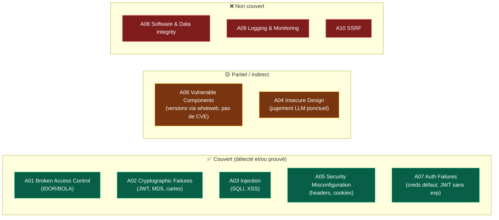
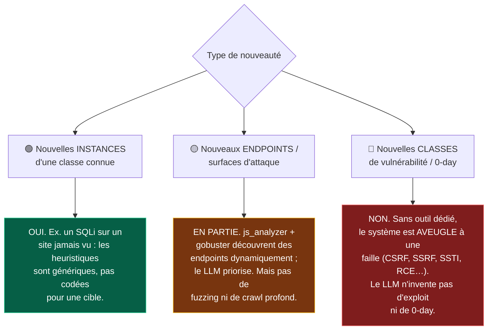
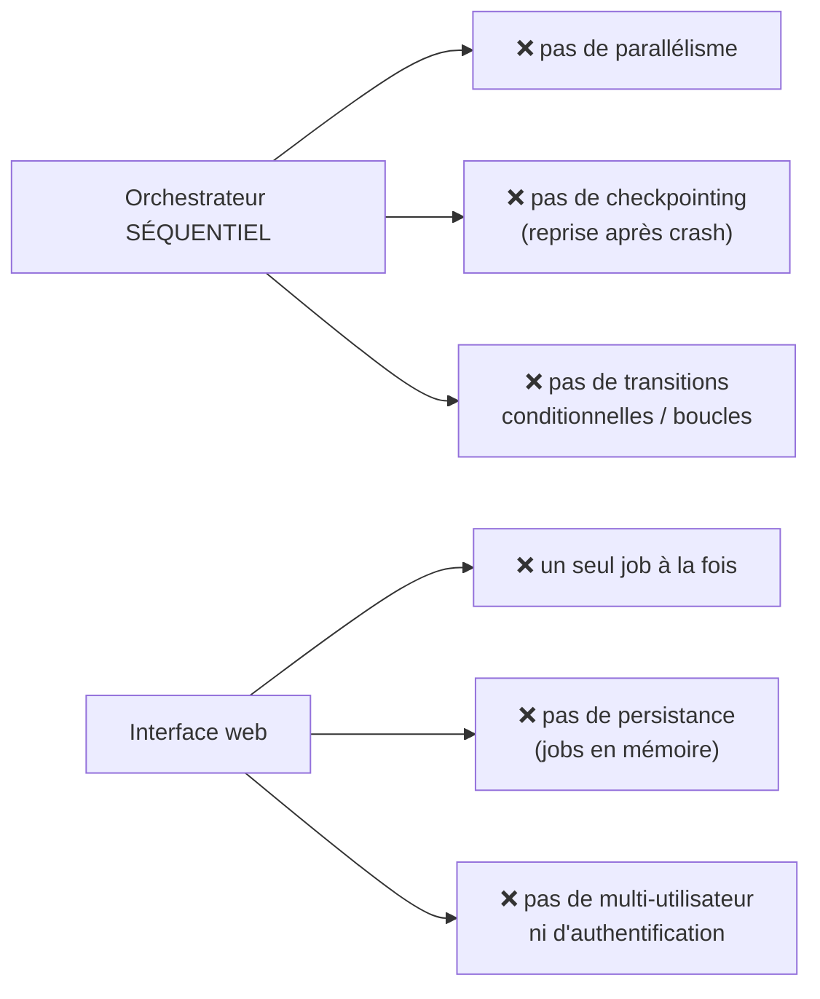

# PENTAGON — Failles gérées & limites du système actuel

> État des lieux honnête de l'outil **tel qu'il existe aujourd'hui**, avant le passage à un outil « pro ».
> Objectif : cadrer ce que PENTAGON sait faire, ce qu'il ne sait **pas encore** faire, et servir de point de départ aux améliorations.

---

## 1. Les failles que le système sait gérer aujourd'hui

Chaque faille est rattachée à un **outil déterministe** (qui agit) et à un **agent** (qui pilote et fait interpréter par le LLM). La colonne **Niveau** distingue :

- **Détectée** = la *condition* de la faille est constatée (ex. en-tête manquant, secret faible) ;
- **Prouvée** = la faille est *exploitée* concrètement (ex. contournement d'auth réussi).

### 1.1 Reconnaissance (passive — agent OSINT)

| Capacité | Outil | Standard | Niveau |
|---|---|---|---|
| Infos WHOIS (registrar, dates, contacts) | `whois` | WSTG-INFO, T1590 | Reconnaissance |
| Enregistrements DNS (A/MX/NS/TXT/CNAME/SOA) | `dns` | WSTG-INFO-04 | Reconnaissance |
| Sous-domaines via Certificate Transparency | `crtsh` | RFC 6962, T1596.003 | Reconnaissance |
| Cartographie SPA : endpoints API, routes, secrets potentiels | `js_analyzer` | WSTG-INFO-08 | Reconnaissance |

### 1.2 Scan & empreinte (active_scan — agent Scanning)

| Capacité | Outil | Standard | Niveau |
|---|---|---|---|
| Ports/services ouverts + versions | `nmap` | T1046, WSTG-INFO-02 | Détectée |
| Répertoires/fichiers cachés (/admin, /.env…) | `gobuster` | WSTG-INFO-08, T1083 | Détectée |
| Empreinte technologies (frameworks, serveur, WAF) | `whatweb` | WSTG-INFO-02 | Détectée |

### 1.3 Analyse applicative (active_scan — agent Web App)

| Faille / capacité | Outil | OWASP / CWE | Niveau |
|---|---|---|---|
| En-têtes de sécurité manquants + cookies non protégés | `security_headers` | A05, WSTG-CONF | Détectée |
| Hashes faibles (MD5/SHA1), mots de passe faibles, cartes (Luhn), secrets exposés | `data_analyzer` | A02, CWE-327/916/311 | Détectée |
| JWT : algo faible, secret faible, absence d'expiration, données sensibles | `jwt_analyzer` | A02/A07, CWE-347/321 | Détectée |
| Exposition de données / contrôle d'accès sur endpoints d'API | `api_prober` | A01, API1 (BOLA) | Détectée |

### 1.4 Exploitation (exploitation — agent Exploitation)

| Faille | Outil | OWASP / CWE | Niveau |
|---|---|---|---|
| Identifiants faibles / par défaut (récupère le token) | `auth_tester` | A07, WSTG-ATHN | **Prouvée** |
| Injection SQL : contournement d'auth + basée sur erreurs + booléenne | `sqli_tester` | A03, CWE-89 | **Prouvée** |
| XSS : réfléchi + stocké (condition serveur) | `xss_tester` | A03, CWE-79 | **Prouvée** |
| XSS : **exécution réelle** confirmée en navigateur | `xss_browser` | A03, WSTG-CLNT-01 | **Prouvée** |
| IDOR / BOLA : accès horizontal aux objets d'autres comptes | `idor_tester` | A01, API1 | **Prouvée** |

### 1.5 Synthèse de couverture OWASP Top 10

**Bilan :** 5 catégories OWASP solidement couvertes (dont 4 avec **preuve**), 2 partielles, 3 absentes.

---

## 2. Peut-il déceler des failles *nouvelles* ?

Réponse nuancée : **oui pour la nouveauté « de surface », non pour la nouveauté « de fond ».**

**En clair :**

- ✅ PENTAGON **généralise** : il trouve les classes qu'il sait tester sur **n'importe quelle cible autorisée** (généricité prouvée sur 2 stacks différentes), sans code spécifique.
- 🟡 Il **découvre** dynamiquement la surface d'attaque (endpoints via bundle JS, répertoires via gobuster) et le LLM **priorise/chaîne** les tests.
- ❌ Il ne **découvre pas** de *classe* de vulnérabilité pour laquelle **aucun outil** n'existe. Le LLM raisonne sur des observations d'outils : **il n'hallucine pas de preuve** (par conception), donc il ne « devine » pas une faille inédite. Pas de 0-day, pas de fuzzing génératif, pas d'apprentissage entre campagnes.

> Formule de synthèse : **le LLM apporte le raisonnement, mais la « vue » du système est bornée par sa boîte à outils.** Élargir la couverture = ajouter des outils.

---

## 3. Les limites du système actuel

### 3.1 Couverture des vulnérabilités

- **Centré Top 10 web.** Rien sur : CSRF, SSRF (A10), SSTI, injection de commande / RCE, path traversal / LFI, désérialisation (A08), open redirect, upload de fichier, race conditions, logique métier.
- **Aucun volet infrastructure/réseau** au-delà de la liste de ports Nmap : pas d'analyse TLS/SSL (protocoles/chiffrements/certificat), pas de SPF/DKIM/DMARC, pas de zone transfer, pas de subdomain takeover.
- **A06 (composants vulnérables) superficiel** : les versions sont détectées (`whatweb`), mais **aucune corrélation CVE** n'est faite.
- **Pas de tests authentifiés multi-rôles** : un seul compte est utilisé ; pas d'escalade verticale de privilèges systématique.

### 3.2 Découverte & profondeur

- **Pas de crawler applicatif** : la surface vient du bundle JS et de gobuster ; les parcours multi-étapes (formulaires, workflows) ne sont pas explorés.
- **Pas de fuzzing** de paramètres ni de mutation intelligente des charges.
- **Pas de chaînage d'exploits** automatisé (ex. IDOR → prise de contrôle → pivot).
- **Pas de mémoire inter-campagnes** : chaque campagne repart de zéro, aucun apprentissage cumulatif.

### 3.3 Architecture & performance

- Orchestrateur **linéaire** : migration LangGraph identifiée mais non faite.
- Interface web = **outil local mono-opérateur** : jobs en mémoire (perdus au redémarrage), un seul job simultané, **aucune authentification** → ne peut pas être exposée publiquement en l'état.
- **Dépendance à la plateforme d'exécution** : la stack LLM + outils réseau tournent sur Kali ; non prévu pour tourner sur un poste bureautique.

### 3.4 Fiabilité du raisonnement LLM

- **Dépendance à un LLM externe** (DeepSeek) : latence, coût, disponibilité, variabilité des sorties.
- **Sensibilité au format** : nécessité du `json_mode` + `max_tokens` élevés pour éviter les analyses tronquées (bug déjà rencontré et corrigé).
- **Faux positifs** filtrés par le **jugement du LLM**, non par une vérification formelle systématique → confiance à surveiller.
- Pas de **garantie de reproductibilité** stricte (part de non-déterminisme du modèle).

### 3.5 Gouvernance & expérience opérateur

- **Scope interactif** (élargissement supervisé du périmètre) disponible **uniquement en CLI**, pas dans l'UI web.
- Pas de **gestion de campagnes** (historique, comparaison, reprise) dans l'interface.
- **Rendu web des diagrammes/rapports** limité ; export **PDF uniquement**, sans suivi de remédiation ni re-test.

### 3.6 Validation & représentativité

- Validé sur **2 cibles maison** volontairement vulnérables (dont VulnShop) → excellent pour la **généricité**, mais **pas un benchmark** d'applications réelles variées.
- **Pas de mesure formelle** de précision/rappel face à une vérité terrain externe (faux négatifs non quantifiés).
- **Aucune couverture destructive** (par choix éthique) → certains impacts (DoS, corruption) ne sont, par principe, jamais évalués.

---

## 4. Tableau récapitulatif des limites → axes d'amélioration

| # | Limite actuelle | Axe d'amélioration (perspective) |
|---|---|---|
| L1 | Couverture centrée Top 10 web | Ajouter familles hors Top 10 (TLS, DNS/e-mail, réseau, config) + CSRF/SSRF/SSTI/LFI |
| L2 | A06 sans corrélation CVE | Brancher une base CVE sur les versions détectées |
| L3 | Pas de crawler ni de fuzzing | Crawler applicatif + fuzzing de paramètres |
| L4 | Orchestrateur séquentiel | Migration **LangGraph** (parallélisme, checkpointing, boucles conditionnelles) |
| L5 | UI locale mono-job sans auth | Backend multi-campagnes **authentifié**, persistant, file d'attente |
| L6 | Scope interactif absent du web | Porter l'élargissement supervisé dans l'UI |
| L7 | Reporting PDF figé | Rapports web interactifs + suivi de remédiation + re-test |
| L8 | Validation sur cibles maison | Benchmark d'applications variées + métriques précision/rappel |
| L9 | Fiabilité LLM variable | Vérification formelle des findings + garde-fous de reproductibilité |

---

## 5. En une phrase

**PENTAGON couvre aujourd'hui, avec preuve, le cœur de l'OWASP Top 10 web sur n'importe quelle cible autorisée, mais reste borné par sa boîte à outils (pas de 0-day, pas de fuzzing, pas de couverture réseau/infra), par un orchestrateur séquentiel et par une interface locale mono-opérateur — autant de points de départ concrets pour le viser « pro ».**
