# PENTAGON — Plan de route vers un outil « pro »

> De prototype académique validé à outil professionnel.
> Ce document décline les **améliorations en lots priorisés**, et **détaille les process et workflows** qui seront mis en place pour chacun.
>
> Il s'appuie sur les limites identifiées (voir [PENTAGON_LIMITES.md](PENTAGON_LIMITES.md), axes **L1→L9**).

---

## 1. Vision cible

Passer d'un outil **séquentiel, local, mono-opérateur, centré Top 10 web** à une **plateforme d'audit continue, multi-utilisateur, extensible et gouvernée**, capable de couvrir web + infra, de découvrir sa surface d'attaque, et de prouver ses résultats à grande échelle.

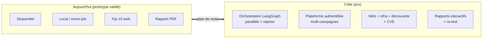

---

## 2. Méthode de priorisation

Chaque amélioration est notée sur **Valeur** (impact soutenance + utilité pro) et **Effort** (charge de dev + risque). On traite d'abord le quadrant **forte valeur / faible effort** (« quick wins »).

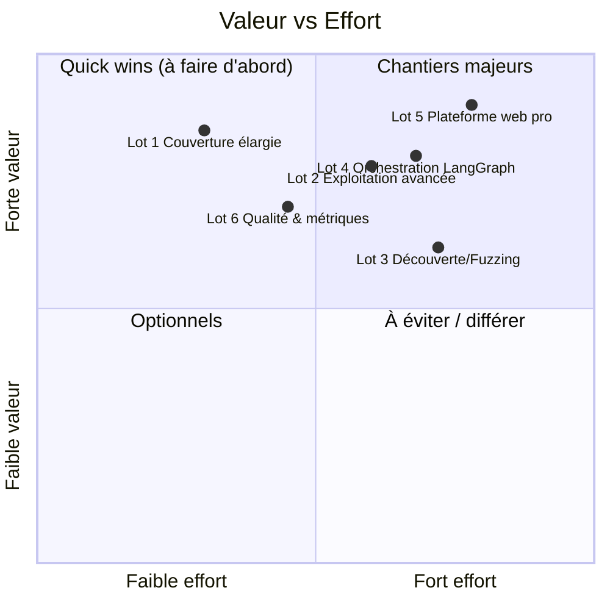

---

## 3. Les lots (vue d'ensemble)

| Lot | Titre | Axes couverts | Valeur | Effort | Phase |
|---|---|---|---|---|---|
| **1** | Couverture élargie (détection) | L1 (partiel), L2 | ⭐⭐⭐ | 🔧 | V1.1 |
| **2** | Exploitation avancée | L1 (reste) | ⭐⭐⭐ | 🔧🔧 | V1.2 |
| **3** | Découverte & fuzzing | L3 | ⭐⭐ | 🔧🔧🔧 | V2.0 |
| **4** | Orchestration LangGraph | L4 | ⭐⭐⭐ | 🔧🔧 | V2.0 |
| **5** | Plateforme web pro | L5, L6, L7 | ⭐⭐⭐ | 🔧🔧🔧 | V2.0 |
| **6** | Qualité, benchmark & métriques | L8, L9 | ⭐⭐ | 🔧🔧 | continu |

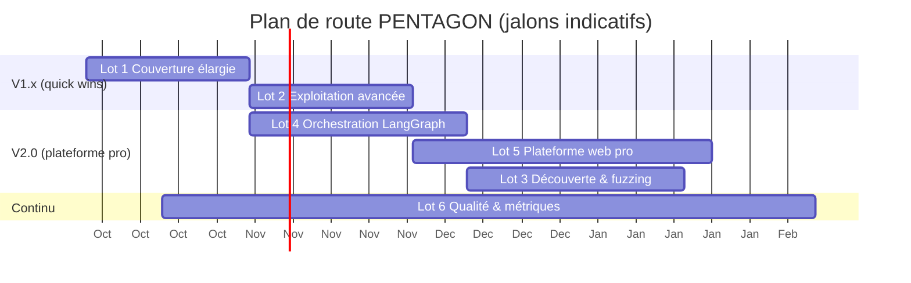

---

## 4. Lot 1 — Couverture élargie (détection)

**Objectif :** ajouter des familles de failles **hors OWASP Top 10 web** et corréler les versions aux CVE, sans nécessiter la catégorie `exploitation`.

**Contenu :**
- **TLS/SSL** : protocoles obsolètes, chiffrements faibles, certificat expiré/auto-signé, HSTS.
- **DNS / e-mail** : SPF/DKIM/DMARC manquants, transfert de zone (AXFR), subdomain takeover.
- **Config HTTP** (extension `security_headers`) : cookies `HttpOnly`/`Secure`/`SameSite`, clickjacking, méthodes HTTP dangereuses.
- **Réseau/services** : analyse enrichie de la sortie Nmap (services exposés, panneaux d'admin).
- **CVE** (L2) : corréler les versions détectées (`whatweb`/`nmap`) à une base CVE.

**Process mis en place — le patron « brancher un nouvel outil » :**

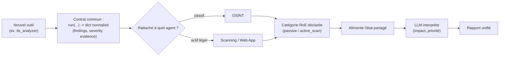

**Workflow d'exécution ajouté (dans les phases existantes) :**

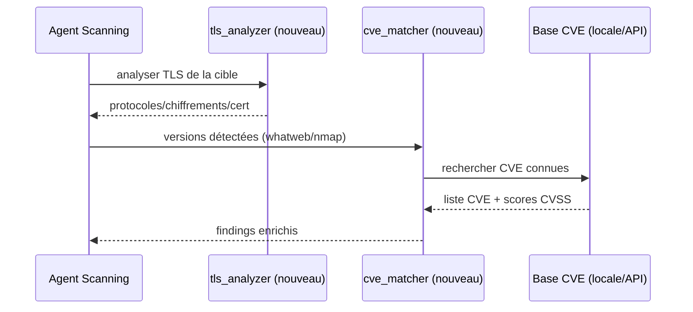

**Livrables :** 4-5 nouveaux outils, mapping RoE, extension du `report_builder` (nouvelles familles), campagne de validation sur Kali.

---

## 5. Lot 2 — Exploitation avancée

**Objectif :** prouver des classes de failles absentes aujourd'hui.

**Contenu :** CSRF, SSRF (A10), SSTI, path traversal / LFI, injection de commande, open redirect ; **tests multi-rôles** (escalade verticale de privilèges).

> **État (avancement) :** ✅ LFI/path traversal, ✅ open redirect, ✅ SSTI
> (A03/CWE-1336, preuve par évaluation d'expression serveur), ✅ SSRF
> (A10/CWE-918, preuve par requête sortante vers un canari), ✅ CSRF
> (A01/CWE-352, preuve par action d'état inter-site sans jeton). Chaque testeur
> est non destructif et branché dans l'agent Exploitation, avec faille
> correspondante semée dans VulnShop. **Reste :** injection de commande,
> tests multi-rôles (escalade verticale).

**Process — cycle « détecter → prouver » étendu (même patron que SQLi/XSS) :**

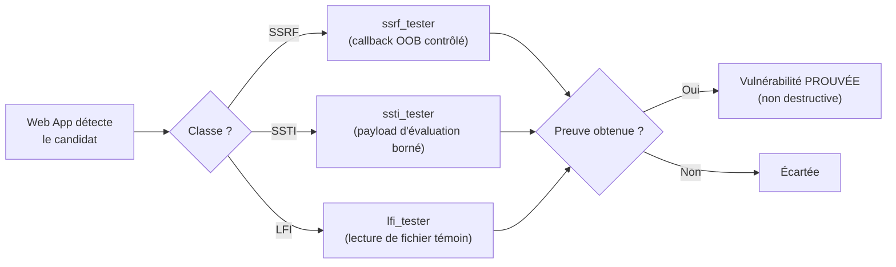

**Garde-fou maintenu :** chaque testeur reste **non destructif** (preuve minimale : marqueur, lecture d'un fichier témoin, callback OOB neutre) — devise « prouver, jamais ravager ». Catégorie `exploitation` requise + RoE.

**Workflow multi-rôles :**

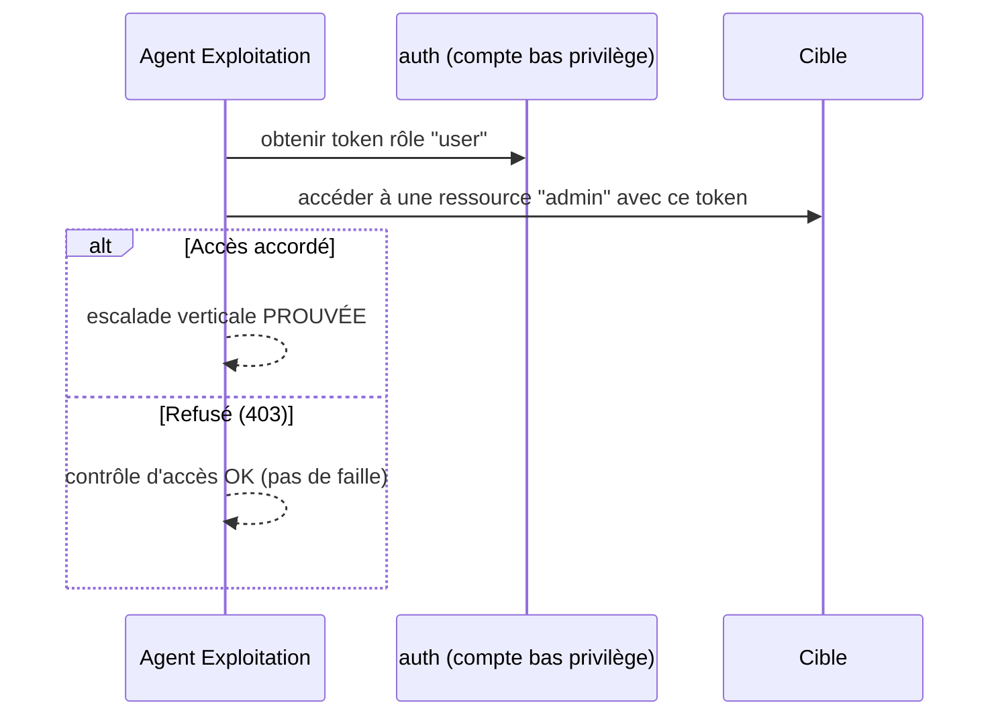

---

## 6. Lot 3 — Découverte & fuzzing

**Objectif :** dépasser la surface « statique » (bundle JS + gobuster) et sonder plus profondément.

**Contenu :** crawler applicatif (suivi de liens/formulaires), fuzzing de paramètres, amorce de **chaînage d'exploits**.

**Workflow — boucle de découverte itérative :**

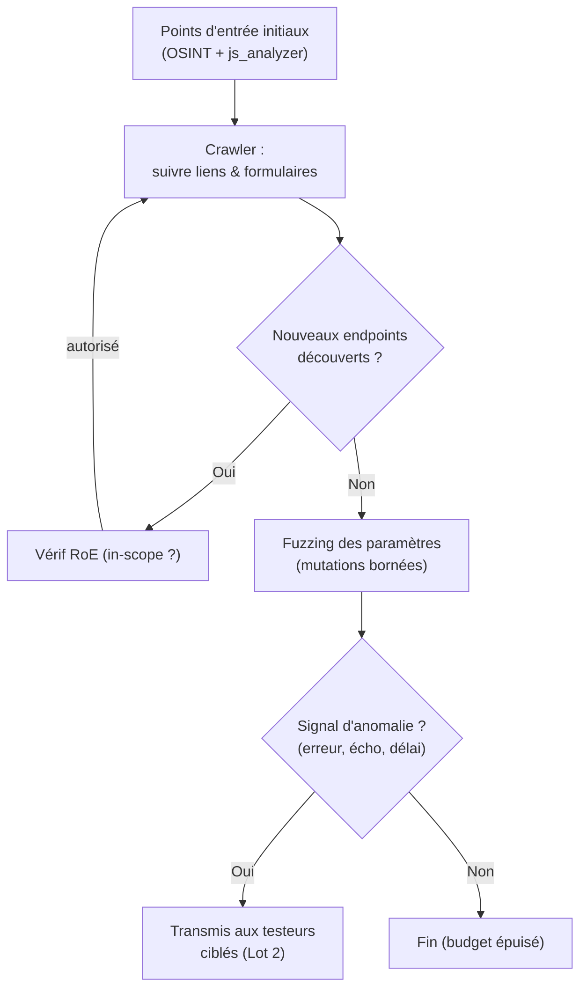

**Garde-fous :** budget de requêtes plafonné (anti-DoS involontaire, respect WAF), périmètre RoE re-vérifié à chaque nouvel endpoint, pas de mutation destructive.

---

## 7. Lot 4 — Orchestration LangGraph

**Objectif :** remplacer l'orchestrateur séquentiel par une **machine à états** : parallélisme, reprise après incident, boucles conditionnelles.

**Process — de la ligne au graphe :**

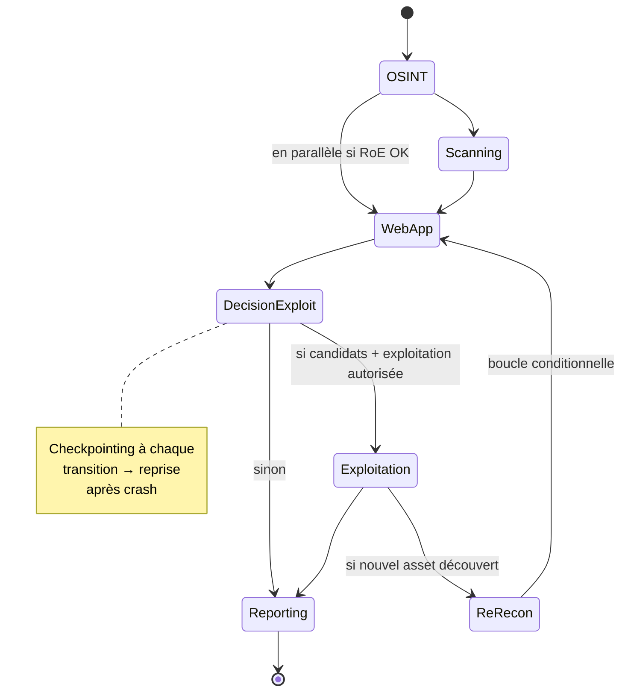

**Apports concrets :**
- **Parallélisme** : Scanning et Web App lancés en concurrence quand ils sont indépendants.
- **Checkpointing** : l'état est persisté à chaque nœud → une campagne interrompue **reprend** où elle s'est arrêtée.
- **Boucles conditionnelles** : un asset découvert en exploitation peut **relancer** une reconnaissance ciblée (sous contrôle RoE).

**Compatibilité :** le contrat des agents (état partagé) est conservé → migration incrémentale, le RoE Enforcer reste le garde-fou de chaque nœud.

---

## 8. Lot 5 — Plateforme web pro

**Objectif :** transformer l'UI locale en **plateforme multi-utilisateur authentifiée**, persistante, avec file d'attente de campagnes et rapports interactifs. (Prérequis absolu pour « accessible n'importe où ».)

**Architecture cible :**

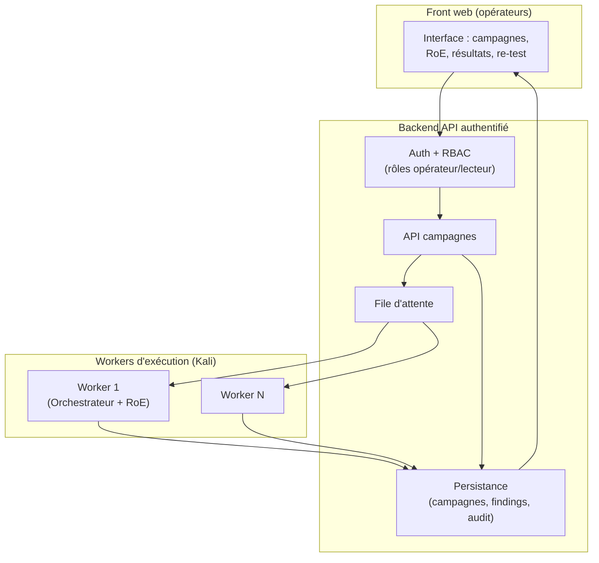

**Workflow — cycle de vie d'une campagne (multi-job) :**

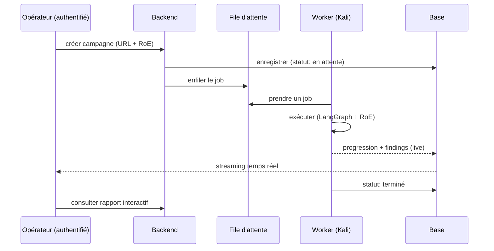

**Workflow — remédiation & re-test (valeur pro clé) :**

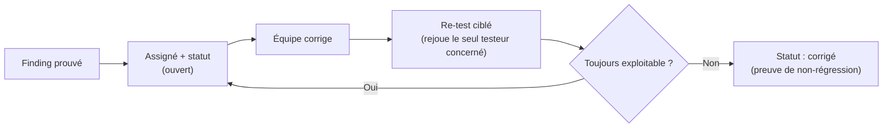

**Sécurité de la plateforme :** authentification obligatoire (jamais de console d'attaque ouverte), RBAC, journal d'audit persistant, isolation des workers, scope interactif porté dans l'UI (L6).

---

## 9. Lot 6 — Qualité, benchmark & métriques

**Objectif :** mesurer et fiabiliser (rigueur académique + confiance pro).

**Contenu :** banc d'essai d'applications vulnérables variées (au-delà des cibles maison), **métriques précision/rappel** vs vérité terrain, vérification formelle des findings, CI/CD.

**Workflow — évaluation mesurée :**

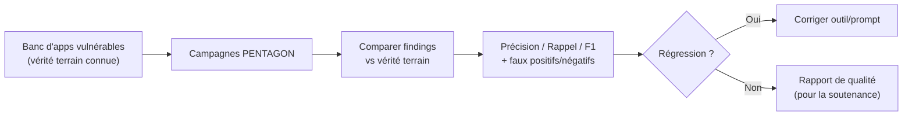

**CI/CD :** tests purs (déjà présents) exécutés automatiquement, non-régression sur le banc, garde-fous de reproductibilité des sorties LLM.

---

## 10. Séquencement recommandé

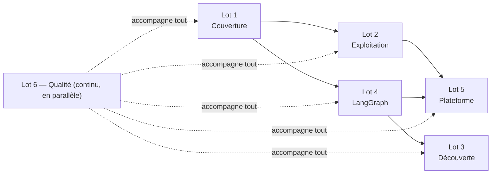

**Logique :**
1. **Lot 1** d'abord (quick win, forte valeur soutenance : « au-delà du Top 10 »).
2. **Lot 4** en parallèle (socle technique pour tout le reste).
3. **Lot 2** (profondeur de preuve), puis **Lot 5** (la plateforme, qui a besoin de LangGraph).
4. **Lot 3** ensuite (découverte, la plus coûteuse).
5. **Lot 6** en continu tout du long.

---

## 11. Résumé

| Priorité | Lot | Ce qu'il change concrètement |
|---|---|---|
| 1 | **Lot 1** | Failles hors Top 10 (TLS, DNS/e-mail, config, réseau) + CVE — sans exploitation |
| 2 | **Lot 4** | Orchestrateur → graphe LangGraph : parallèle, reprise, boucles |
| 3 | **Lot 2** | Preuve de CSRF/SSRF/SSTI/LFI + escalade de privilèges |
| 4 | **Lot 5** | Plateforme authentifiée, multi-campagnes, re-test, rapports interactifs |
| 5 | **Lot 3** | Crawler + fuzzing = découverte profonde de la surface |
| — | **Lot 6** | Métriques précision/rappel + CI/CD (en continu) |

**Le Lot 5 (plateforme web pro) est le point d'aboutissement de l'expérience utilisateur** — c'est là que la « directive visuelle de l'expérience web au-delà du CLI » prendra place (à réaliser sur ta demande).
