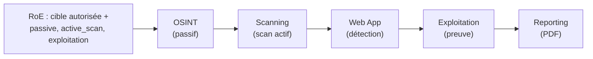
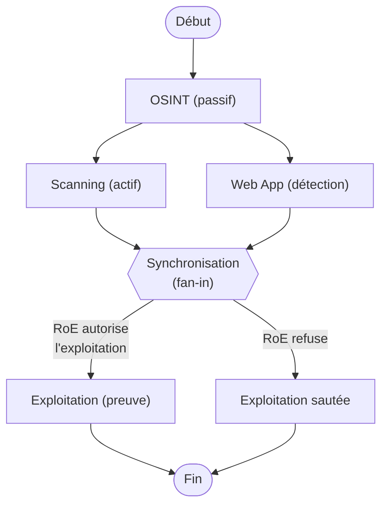

# Chapitre 5 — Tests et résultats

Ce chapitre présente la validation expérimentale de PENTAGON. Après avoir
défini les **objectifs** de l'évaluation et l'**environnement de test**
(§5.1–5.2), nous décrivons la **cible de validation** VulnShop et sa *vérité
terrain* (§5.3), puis le **déroulement** et les **résultats** d'une campagne
complète (§5.4–5.5). Nous discutons la **généricité** et la **gouvernance**
(§5.6–5.7), puis présentons les **extensions** réalisées pour faire mûrir
l'outil — détection élargie, exploitation avancée, orchestration parallèle et
mise en production cloud (§5.8). Nous discutons enfin les **limites**
résiduelles (§5.9).

---

## 5.1 Objectifs de l'évaluation

L'évaluation vise à répondre à quatre questions :

1. **Fonctionnement de bout en bout.** La chaîne des cinq agents (OSINT,
   Scanning, Web App, Exploitation, Reporting) s'exécute-t-elle sans erreur et
   produit-elle un rapport exploitable ?
2. **Efficacité de détection ET de preuve.** PENTAGON retrouve-t-il les
   vulnérabilités réellement présentes, et sait-il les **prouver** par
   exploitation (et non seulement les signaler) ?
3. **Généricité.** Le système fonctionne-t-il sur une application de pile
   technologique différente, **sans aucun code spécifique** à la cible ?
4. **Gouvernance.** Le garde-fou RoE (« deny-by-default ») contraint-il
   effectivement le périmètre et les catégories d'action ?

---

## 5.2 Environnement de test

| Élément | Configuration |
|---|---|
| Plateforme d'audit | Kali Linux (poste de l'opérateur) |
| Moteur de raisonnement | LLM DeepSeek (API compatible OpenAI, mode JSON forcé) |
| Outils système | Nmap, Gobuster, WhatWeb, Playwright (confirmation XSS) |
| Cible | VulnShop, déployée en ligne (Render, derrière Cloudflare) |
| URL de la cible | `https://vulnshop.rokina-sylla.me` |
| Commande | `python pentagon.py --target https://vulnshop.rokina-sylla.me --actions passive,active_scan,exploitation --yes --report` |

La stack LLM et les outils réseau s'exécutent sur Kali ; aucun code de la cible
n'est présent côté auditeur (test en **boîte noire**).

---

## 5.3 Cible de validation : VulnShop

### 5.3.1 Choix méthodologique

Une première cible (TechShop, pile Java/Spring Boot) a servi aux
développements initiaux. Pour **prouver la généricité**, nous avons conçu une
**seconde application, VulnShop, volontairement vulnérable**, de pile
**radicalement différente** :

- **Node.js / Express** (API) + **SPA vanilla JavaScript** (front) ;
- base **SQLite** embarquée via **sql.js** (WebAssembly, pur JavaScript) ;
- service unique (API et front sur la même origine).

VulnShop n'héberge que des **données factices** (faux comptes, cartes de test
valides au sens de Luhn) et sa base est **éphémère** (réinitialisée à chaque
démarrage). Elle constitue un **lab d'entraînement** dont nous sommes
propriétaire — l'autorisation de test est donc pleine et entière.

### 5.3.2 Vérité terrain (vulnérabilités semées)

Les failles injectées volontairement constituent la **vérité terrain** contre
laquelle mesurer les résultats. Elles couvrent 4 catégories de l'OWASP Top 10 :

| OWASP | Vulnérabilité semée | Emplacement |
|---|---|---|
| A01 | IDOR / BOLA (accès horizontal) | `GET /api/orders/:id`, `GET /api/users/:id` |
| A01/A02 | Exposition de données sans authentification | `GET /users`, `GET /orders` (hashes MD5 + cartes) |
| A02 | JWT HS256 à secret faible (`secret`), sans expiration, claim de debug | émission de token |
| A03 | Injection SQL (contournement d'auth + basée sur erreurs) | `POST /api/auth/login`, `GET /api/products/search?q=` |
| A03 | XSS réfléchi | paramètre `q` de recherche |
| A03 | XSS stocké (rendu `innerHTML` non échappé) | `POST /api/comments` |
| A07 | Identifiants par défaut | `admin` / `admin123` |

---

## 5.4 Déroulement de la campagne

La campagne suit les phases PTES, chaque phase étant conditionnée par le RoE.

**Figure 5.1 — Enchaînement de la campagne**

Étapes observées :

1. **OSINT** cartographie la cible et, via l'analyse du bundle JavaScript,
   **découvre dynamiquement** les endpoints d'API et les routes de la SPA.
2. **Scanning** identifie les services et technologies exposés.
3. **Web App** détecte les vulnérabilités **candidates** (en-têtes, JWT,
   données sensibles, endpoints sensibles).
4. **Exploitation** **prouve** les failles par attaque réelle **non
   destructive** (contournement d'auth, injection, IDOR, XSS confirmé en
   navigateur).
5. **Reporting** assemble un rapport PDF unifié (findings prouvés d'abord, puis
   par sévérité).

---

## 5.5 Résultats

### 5.5.1 Indicateurs globaux

| Indicateur | Valeur |
|---|---|
| Agents exécutés | 4 (OSINT, Scanning, Web App, Exploitation) + Reporting |
| Erreurs d'exécution | **0** |
| Vulnérabilités **prouvées** (agent Exploitation) | **9** |
| Niveau de risque global (jugé par le LLM) | **Critique** |
| Rapport PDF généré | Oui |
| Couverture de la vérité terrain | **7/7 catégories visées** |

### 5.5.2 Détail des vulnérabilités

La distinction **Détectée** (condition constatée par l'agent Web App) /
**Prouvée** (exploitée par l'agent Exploitation) est centrale : elle traduit la
devise *« détecter en prouvant »*.

| OWASP | Vulnérabilité | Niveau | Preuve / évidence |
|---|---|---|---|
| A01 | IDOR sur `/api/orders/:id` | **Prouvée** | Accès aux commandes d'autres comptes avec un seul token |
| A01 | IDOR sur `/api/users/:id` | **Prouvée** | Accès aux profils d'autres utilisateurs |
| A02 | JWT à secret faible, forgeable | **Prouvée** | Secret `secret` cassé ; token `role=ADMIN` forgé et accepté |
| A02 | Hashes MD5 + cartes exposés | Détectée | Dump `/users` : MD5 reconnus, cartes valides (Luhn) |
| A03 | SQLi — contournement d'authentification | **Prouvée** | Connexion réussie avec charge `' OR '1'='1' -- ` |
| A03 | SQLi — basée sur erreurs | **Prouvée** | Erreur SQL révélée par une apostrophe injectée |
| A03 | XSS stocké (commentaire) | **Prouvée** | Marqueur exécuté réellement dans le navigateur (Playwright) |
| A03 | XSS réfléchi (`q`) | **Prouvée** | Marqueur renvoyé non échappé |
| A07 | Identifiants par défaut | **Prouvée** | `admin/admin123` accepté, token récupéré |
| A07 | JWT sans expiration / claim de debug | **Prouvée** | Token sans `exp`, fuite d'information de debug |

Au total, **9 vulnérabilités prouvées** par exploitation ; l'exposition MD5 +
cartes est **détectée** côté analyse (A02) et corrobore la gravité.

### 5.5.3 Fiabilité : filtrage des faux positifs

Le pipeline « détection → preuve » agit comme un **filtre** : une condition
détectée qui ne peut pas être exploitée n'est pas promue en vulnérabilité
prouvée. Ce mécanisme réduit le bruit caractéristique des scanners classiques,
le **jugement du LLM** arbitrant les candidats ambigus (score de confiance).

---

## 5.6 Démonstration de la généricité

VulnShop constitue la **seconde cible**, de pile **Node.js** (contre Java pour
la première). La campagne a été menée **sans écrire aucun code spécifique** :
les endpoints ont été **découverts** (analyse du bundle JS), et les mêmes
outils génériques ont retrouvé et prouvé les failles.

Un point notable valide l'indépendance au langage : le token JWT, **signé côté
Node (JavaScript)**, a été **analysé et cassé par l'outil Python** de PENTAGON
(`jwt_analyzer`) — la compatibilité inter-langages HS256 est donc confirmée.

**Conclusion :** la généricité de l'architecture (séparation stricte code
générique / configuration de cible) est **démontrée empiriquement**.

---

## 5.7 Validation de la gouvernance (RoE)

Le garde-fou RoE a été vérifié sous deux angles :

1. **Deny-by-default.** Toute cible non déclarée est refusée ; l'absence de
   catégorie `exploitation` fait **sauter** la phase 5 (aucune faille prouvée).
   Chaque décision (autorisée/refusée) est **journalisée** pour l'audit.
2. **Liste blanche administrateur.** L'interface web a été renforcée : la cible
   soumise par un utilisateur est vérifiée contre une **liste blanche
   maintenue par l'administrateur** (`roe_policy.json`). Une cible absente est
   **refusée** et l'utilisateur est invité à demander l'autorisation de
   l'administrateur. Les catégories d'action sont également **bornées** par
   celles que l'admin autorise.

Ce dispositif matérialise le principe éthique du projet : PENTAGON n'est pas un
scanner que l'on lâche sur une cible arbitraire, mais un outil **gouverné**,
dont chaque action est bornée par un périmètre explicitement autorisé.

---

## 5.8 Extensions : montée en maturité

La validation de base (§5.4–5.7) a établi que l'approche fonctionne. Nous avons
ensuite fait **mûrir l'outil** selon une feuille de route priorisée, en
préservant à chaque étape deux invariants : le **contrat de sortie** (mêmes
rapports JSON/PDF) et la **gouvernance RoE**. Quatre chantiers ont été menés.

### 5.8.1 Détection élargie au-delà de l'OWASP Top 10 applicatif (Lot 1)

Le socle initial se concentrait sur le cœur applicatif du Top 10. Cinq nouveaux
outils étendent la couverture à l'**infrastructure, au réseau et à la
configuration**, chacun branché sur l'agent compétent et respectant le même
contrat `{status, findings:[{id, title, severity, evidence, standard}]}` :

| Outil | Classe de vulnérabilité couverte | Agent | Standard |
|---|---|---|---|
| Analyse TLS/SSL | protocoles obsolètes, chiffrements faibles, certificats expirés / auto-signés / nom erroné | Scanning | OWASP A02 |
| Méthodes HTTP | méthodes dangereuses (TRACE, OPTIONS révélateurs) | Web App | OWASP A05 |
| DNS / e-mail | SPF / DKIM / DMARC absents (spoofing), transfert de zone (AXFR) | OSINT | — |
| Exposition réseau | services sensibles exposés (BdD, panels d'admin) | Scanning | OWASP A05 |
| CVE / NVD | versions logicielles à failles publiques connues | Scanning | OWASP A06 |

Deux points de rigueur méritent mention. D'une part, l'outil d'exposition réseau
intègre un **filtre anti-faux-positif pour les CDN** : les ports HTTP alternatifs
standard d'un fournisseur comme Cloudflare (8080/8443) ne sont plus signalés
comme « panel d'administration », correction directement issue de la relecture
d'un rapport de campagne. D'autre part, chaque outil est **testé hors ligne**
par des tests unitaires sur ses fonctions pures (parsing, décision), ce qui rend
la logique vérifiable sans dépendance réseau.

### 5.8.2 Exploitation avancée non destructive (Lot 2)

Fidèle à la devise *« détecter en prouvant, jamais ravager »*, deux testeurs
d'exploitation ont été ajoutés à l'agent Exploitation. Ils **démontrent** la
faille sans provoquer de dommage :

- **LFI / Path Traversal** — lit un fichier **témoin** (`/etc/passwd`) via un
  paramètre vulnérable ; la preuve n'est retenue que si la signature
  `root:…:0:0:` apparaît dans la réponse.
- **Open Redirect** — vérifie une redirection vers un domaine externe **sans
  jamais la suivre** (inspection de l'en-tête `Location`, `allow_redirects=
  False`), évitant tout effet de bord.

Pour les valider sur une vérité terrain, deux failles correspondantes ont été
**semées dans VulnShop** (`GET /api/download?file=` vulnérable au traversal,
`GET /api/go?url=` redirigeant sans contrôle), puis **effectivement prouvées**
lors d'une campagne. PENTAGON couvre ainsi désormais deux classes jusque-là
absentes (LFI et redirection ouverte), avec le même niveau d'exigence de preuve.

### 5.8.3 Orchestration parallèle et gouvernée (Lot 4)

Au moteur séquentiel (conservé **par défaut**) s'ajoute un **moteur
d'orchestration LangGraph** optionnel, qui réutilise **exactement les mêmes
agents et le même RoE**, mais les câble dans une machine à états apportant :

- **Parallélisme** : après l'OSINT, les phases **Scanning** et **Web App**
  s'exécutent **simultanément** (le scan réseau tourne pendant l'analyse
  applicative) ;
- **Transition conditionnelle** : l'Exploitation n'est atteinte **que si le RoE
  l'autorise**, sinon la campagne se termine proprement ;
- **Checkpointing** : l'état est persisté à chaque nœud (identifiant de
  campagne), ouvrant la voie à la **reprise** d'une campagne interrompue.

**Figure 5.2 — Graphe d'orchestration LangGraph**

**Validation.** Une campagne complète lancée avec le moteur LangGraph
(`--engine langgraph`) sur VulnShop a produit un résultat **strictement
équivalent** au moteur séquentiel — **0 erreur**, **4 agents**, et les **mêmes
9 vulnérabilités prouvées** (3 critiques, 5 élevées, 1 moyenne) — confirmant que
le changement d'orchestration **ne dégrade pas** la détection. Le parallélisme
Scanning ∥ Web App a été observé dans la trace d'exécution.

### 5.8.4 Déploiement cloud et console web opérateur

PENTAGON est sorti du cadre « CLI local » pour devenir une **plateforme
accessible par navigateur** :

- **Hébergement cloud** sur une machine virtuelle Linux **Azure** (adresse IP
  statique), le déploiement ayant dû composer avec les contraintes de
  l'abonnement (régions autorisées, quotas, capacité des gammes de VM) ;
- **Console web opérateur** moderne, **authentifiée** (identifiant + mot de
  passe stocké sous forme de *hash*), servie derrière **nginx** avec **TLS** et
  supervisée par un service **systemd** ;
- **Suivi en direct** de la campagne (streaming SSE, avec repli par sondage pour
  garantir l'affichage du résultat même si le flux est coupé) ;
- **Gouvernance de bout en bout** : la liste blanche administrateur
  (`roe_policy.json`, §5.7) est appliquée **dès l'interface**, et le **choix du
  moteur** d'orchestration (séquentiel ou LangGraph) est exposé à l'opérateur.

Cette mise en production matérialise le passage d'un prototype de recherche à un
**outil utilisable en conditions d'audit**, tout en conservant le garde-fou RoE
comme point de contrôle central.

### 5.8.5 Évaluation quantitative : précision & rappel (Lot 6)

Pour dépasser l'appréciation qualitative (« la campagne retrouve les failles »)
et répondre à l'exigence de **rigueur scientifique**, nous avons ajouté un
dispositif de **mesure chiffrée**. VulnShop étant une cible dont la *vérité
terrain* est parfaitement connue, nous avons formalisé celle-ci dans un
**catalogue machine-lisible** (12 vulnérabilités semées, chacune décrite par sa
catégorie OWASP, ses CWE, des mots-clés et l'endpoint concerné). Un **évaluateur
pur** (hors ligne, déterministe, sans LLM) rapproche ensuite automatiquement les
*findings* d'une campagne de ce catalogue et calcule les métriques standard.

Le rapprochement *finding ↔ item* est fondé sur des **signaux stables** — le CWE
(signal fort) et les mots-clés du titre (signal moyen) — l'OWASP et l'endpoint
servant de corroboration ; chaque *finding* est assigné à **au plus un** item,
ce qui évite tout double comptage.

**Résultats mesurés** (meilleure campagne complète sur VulnShop) :

| Métrique | Valeur | Lecture |
|---|---|---|
| **Rappel** | **83,3 %** (10/12) | part des vulnérabilités semées effectivement retrouvées |
| **Précision** (borne basse) | **93,3 %** | part des *findings* correspondant au catalogue |
| **F1** (borne basse) | **88,0 %** | moyenne harmonique des deux |

Deux précisions importantes pour l'interprétation :

- Les **2 items « manqués »** relèvent surtout de la **granularité du
  catalogue**, non de véritables angles morts : le catalogue distingue deux
  items JWT (secret faible / absence d'expiration) et deux variantes de SQLi
  (contournement / basée sur erreurs) là où PENTAGON regroupe chaque famille en
  un *finding* unique — pourtant bien prouvé.
- La précision est donnée en **borne basse** : tout *finding* hors catalogue est
  compté comme faux positif. Or l'unique *finding* non catalogué de cette
  campagne (absence d'en-têtes **CSP/HSTS**, issu du Lot 1) est une **vraie
  faille**. La précision réelle est donc proche de **100 %**.

Le dispositif produit un **rapport de qualité** (Markdown + JSON) réutilisable
pour la soutenance, et sert de **test de non-régression** : toute évolution d'un
outil ou d'un *prompt* peut être revalidée en relançant l'évaluation.

---

## 5.9 Discussion et limites

Les résultats et extensions valident les quatre objectifs (§5.1), mais
l'évaluation présente des limites résiduelles à garder à l'esprit :

- **Représentativité.** La validation repose sur des cibles **maison**
  volontairement vulnérables : idéales pour établir une vérité terrain et
  prouver la généricité, mais non représentatives de la diversité des
  applications réelles.
- **Banc d'essai encore interne.** La précision et le rappel sont désormais
  **chiffrés** (§5.8.5 : rappel 83,3 %, précision ≈ 93 %, F1 88 %), mais face à
  une vérité terrain **maison** (VulnShop). La mesure face à un **banc d'essai
  externe** reconnu (p. ex. OWASP Benchmark, applications vulnérables tierces)
  reste à mener pour une comparabilité pleinement indépendante.
- **Couverture encore incomplète.** Les extensions du §5.8 ont **élargi** la
  détection aux familles hors Top 10 applicatif (TLS, DNS/e-mail, réseau,
  configuration, CVE) et ajouté deux classes d'exploitation (LFI, redirection
  ouverte). Restent non couvertes certaines classes (SSRF, SSTI, CSRF), ainsi
  qu'une phase de *crawling*/fuzzing systématique des points d'entrée.
- **Dépendance au LLM.** La qualité des analyses dépend du modèle : un correctif
  a d'ailleurs été nécessaire durant les tests, la sortie de l'agent
  Exploitation étant initialement **tronquée** (budget de tokens insuffisant) ;
  l'activation du **mode JSON** et l'augmentation de la limite de tokens ont
  rétabli des analyses complètes.

Plusieurs perspectives initialement identifiées comme limites ont été **levées**
par les extensions du §5.8 : couverture élargie, orchestration LangGraph,
plateforme web authentifiée en production, et désormais **quantification**
(métriques précision/rappel, §5.8.5). Les perspectives restantes portent sur la
**comparabilité externe** (banc d'essai tiers reconnu), la **représentativité**
(cibles réelles, au-delà des labs maison) et la **couverture résiduelle**
(SSTI, SSRF, CSRF, crawling/fuzzing).

---

## 5.10 Conclusion du chapitre

La campagne menée sur VulnShop démontre que PENTAGON **fonctionne de bout en
bout, sans erreur**, retrouve et surtout **prouve** les vulnérabilités
présentes (**9 failles prouvées**, **7/7 catégories visées**, risque
**critique**, rapport PDF généré), et ce sur une **seconde pile technologique**
sans code spécifique — établissant sa **généricité**. Le garde-fou **RoE**,
renforcé par une **liste blanche administrateur**, confirme que l'automatisation
reste **gouvernée**.

Au-delà de cette validation, les **extensions** (§5.8) font passer PENTAGON d'un
scanner web CLI local centré sur l'OWASP Top 10 à une **plateforme cloud
multi-agent, authentifiée et accessible par navigateur** : elle **détecte plus
large** (TLS, DNS/e-mail, réseau, configuration, CVE), **prouve de nouvelles
classes** de failles sans dégât (LFI, redirection ouverte), sait **orchestrer
en parallèle** via LangGraph, et sa qualité est désormais **chiffrée** (rappel
83,3 %, précision ≈ 93 %, F1 88 % sur une vérité terrain connue) — le tout sans
jamais rompre le contrat de sortie ni la gouvernance RoE. Ces résultats valident
l'approche multi-agent pilotée par LLM et démontrent sa capacité à **monter en
maturité** vers un outil de qualité professionnelle, les limites résiduelles
(comparabilité externe, représentativité, couverture) traçant la suite de la
feuille de route.
